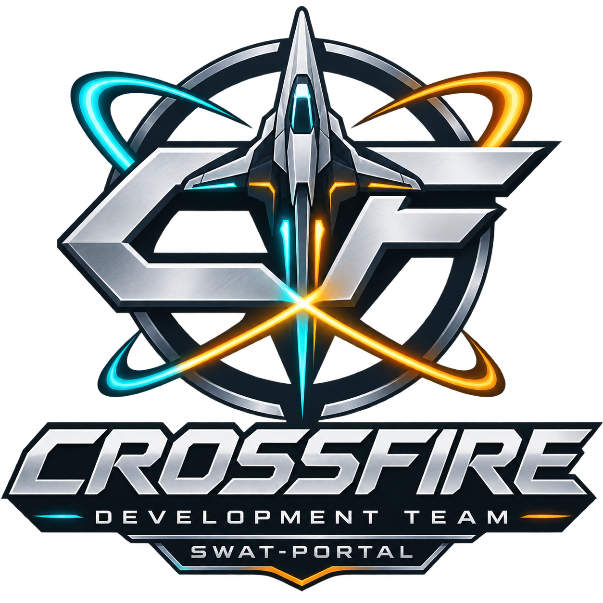

# Crossfire Development Team

**Building the next chapter of Freelancer: Crossfire.**

[SWAT-Portal](https://swat-portal.com/forum/) · [Discover Crossfire](https://swat-portal.com/forum/crossfire-page-en/) · [Crossfire Wiki](https://swat-portal.com/forum/cms/wiki/crossfire/)

## Who we are

We develop and maintain software for **Crossfire**, the Freelancer mod from the
**SWAT-Portal** community. Our work supports the people exploring its universe,
playing through its stories, and keeping its servers running.

Freelancer is where it started. Keeping Crossfire moving is what brings us together.

## What we work on

- **Server software and plugins** — maintaining Crossfire's FLHook-based server
  extensions and multiplayer features.
- **Campaign and gameplay extensions** — supporting new stories and building on
  the possibilities of the Freelancer engine.
- **Development tools** — making it easier to build, test, and maintain Crossfire.
- **Stability and compatibility** — improving a long-lived codebase while respecting
  the game and the systems our community relies on.

Some development takes place in private repositories. Access is coordinated by
the team; this profile is our public introduction.

## Get involved

Enjoy C++, modding, mission scripting, testing, or writing documentation?
Introduce yourself on [SWAT-Portal](https://swat-portal.com/forum/) and tell us
what you would like to work on.

For repositories you can access, start with their README and contribution guide.
Keep changes focused, explain how you tested them, and discuss larger ideas before
starting an implementation.

## Playing Crossfire or looking for help?

Visit the [Crossfire page](https://swat-portal.com/forum/crossfire-page-en/) for
an introduction, the [community forum](https://swat-portal.com/forum/) for
discussion and support, and the [wiki](https://swat-portal.com/forum/cms/wiki/crossfire/)
for gameplay information.

---

**Crossfire Development Team · SWAT-Portal**

A community modding project for Freelancer.

